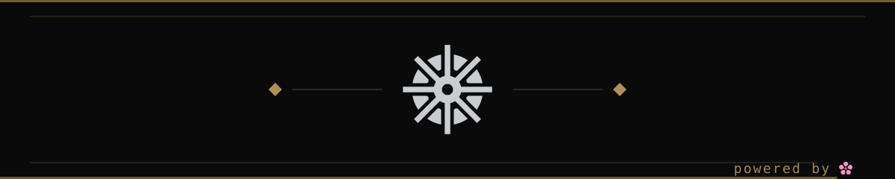

<p align="center">
  
</p>

<h1 align="center">KanXh1nPum</h1>

A cost-aware simulation lab and a guided tour through trading timeframes, built for someone
who has never invested and lives in Chile.

**What this is not:** a signal service, a profitable bot, financial advice, or a promise.
It is a lab that shows what actually lands in your account after spread, commission,
slippage, currency and inflation — and a tour that explains why the timeframes you choose
change the game you are playing.

## The thesis

The shorter the timeframe, the less the market pays you for patience and the more you have
to earn through skill. Over years, an index hands you the risk premium for free. Over
minutes, you are competing with machines that pay for colocation and you are paying worse
fees than they are.

Every screen in the tour exists to make that sentence visible with numbers instead of prose.

## The Chilean anchor

Returns are meaningless without a benchmark. As of October 2026 (Banco Central de Chile,
INE), the thing your money does at a bank is:

| Instrument | Nominal annual | Real (vs 4.5% CPI) |
| --- | --- | --- |
| DPF 30-89 days (system average) | 4.17% | -0.3% before tax |
| DPF 90 days - 1 year (system average) | 4.60% | +0.1% before tax |
| DPF 1-3 years (system average) | 5.40% | +0.9% before tax |
| Policy rate (TPM) | 4.50% | 0.0% |

Interest income is taxed, so the real return after tax can be negative. That is the honest
baseline any strategy has to beat, and the dashboard never hides it.

## Quick start

```bash
uv sync --extra dev --extra data --extra app
uv run kx data fetch --symbol SPY --start 2005-01-01
uv run kx app
```

## The demo account

The dashboard simulates. The bot trades a real Alpaca **paper** account, so the order and
the chart are charged by the same cost model:

```bash
uv sync --extra bot
uv run kx bot plan       # what it would do: no network, no keys
uv run kx bot run        # reads the paper account, sends nothing
uv run kx bot run --send # sends the order to the demo account
```

`--strategy sma-cross` runs the second stop's rule against the same account. There is no
live path: `--live` is refused on purpose. Keys live in your shell
(`KX_ALPACA_KEY`, `KX_ALPACA_SECRET`), never in the dashboard. [`docs/bot.md`](docs/bot.md)
is the runbook.

## What the tour shows, with numbers from 2005-2026

Saving CLP 500,000 and then CLP 50,000 a month into the index, with a broker's spread,
slippage and commission applied:

| | |
| --- | --- |
| Money contributed | CLP 13,600,000 |
| Account today | CLP 120,679,900 |
| Same money in a 90d-1y deposit at 4.6% | CLP 23,615,896 |

Same period, same deposits, five times apart. That is not a forecast and not a strategy:
it is the risk premium paid for holding through 2008, 2020 and 2022 without selling. The
dashboard also shows what happens if you sell at -20%, if you miss the ten best days, and
how long each drawdown took to recover.

## Status

The tour has four stops live: the Chilean reality check, buy & hold, crossing averages,
and what moving more often costs. Every trading stop runs through the same cost ledger,
which is the point — change the rule, keep the arithmetic. Intraday is deliberately
absent: the cache is daily bars, so there is no data that could represent trading several
times a day, and the last stop measures the cost of frequency instead of pretending. The
v1 plan and its specs live in [`odd/tasks/v1-guided-tour.md`](odd/tasks/v1-guided-tour.md);
reuse decisions and rejected alternatives live in
[`docs/decisions.md`](docs/decisions.md).

## Tests

```bash
uv run pytest        # 136 tests, no network required
uv run ruff check
```

The ledger is mutation-checked: removing sell-side costs, the commission share, or the CPI
deflator each breaks a test. That is the claim this repo makes as a portfolio piece — the
engine cannot quietly cheat.

## Disclaimer

Educational and experimental software. Nothing here is investment advice, nor a
recommendation to buy or sell any instrument. Past performance is not indicative of future
results. Simulated results are not real trading results. If you cannot afford to lose the
money, do not put it at risk.

## License

MIT.

---

<p align="center">
  <sub><strong>motor · Gentle Shell</strong> · MIT</sub>
</p>
